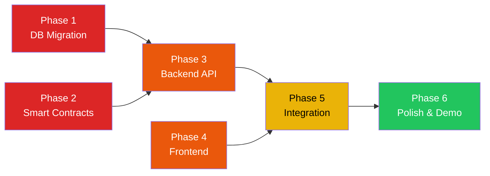

# TasteChain BKK — Implementation Plan
**Version:** 1.0  
**Last Updated:** 2026-10-15  
**Reference:** [TastechainPRD.md (v2.1)](file:///d:/2026/2026_10Oct/Uhack/TastechainPRD.md)  
**Working Directory:** `d:\2026\2026_10Oct\Uhack`

---

## Overview



> Phase 1 & 2 ทำขนานกันได้ (ไม่พึ่งพากัน)  
> Phase 3 & 4 ทำขนานกันได้ (Backend & Frontend แยกอิสระ)  
> Phase 5 ต้องรอ Phase 3 + 4 เสร็จก่อน  

---

## Phase 1: Database Migration & Data Validation

### เป้าหมาย
สร้าง 3 ตารางใหม่ (`verified_reviews`, `pioneer_claims`, `merchant_bounties`) ใน DB `tastechain` และตรวจสอบว่าข้อมูล `places` เดิม 41K+ ร้านพร้อมใช้งาน

### Tasks

| # | Task | รายละเอียด |
| :--- | :--- | :--- |
| 1.1 | สร้างไฟล์ SQL Migration | เขียน `migrations/001_create_tastechain_tables.sql` ตาม Schema ใน PRD Section 5 |
| 1.2 | รัน Migration | Execute SQL ผ่าน `docker exec uhack-postgres psql ...` |
| 1.3 | ตรวจสอบ FK Constraints | ยืนยันว่า 3 ตารางใหม่ reference ไปยัง `places(place_id)` ถูกต้อง |
| 1.4 | สร้าง DB query filter สำหรับ กทม. | เตรียม View หรือ Query template: `city = 'กรุงเทพมหานคร' AND business_status = 'OPERATIONAL'` |
| 1.5 | ทดสอบ Insert/Read ตาราง companion | ใส่ข้อมูลตัวอย่าง 2-3 แถวใน `verified_reviews` และ `pioneer_claims` |

### ✅ Testing & Verification Checklist

```
[ ] T1.1  ตาราง verified_reviews สร้างสำเร็จ — รัน \dt แล้วเห็นตาราง
[ ] T1.2  ตาราง pioneer_claims สร้างสำเร็จ — UNIQUE constraint (place_id, slot_index) ทำงาน
[ ] T1.3  ตาราง merchant_bounties สร้างสำเร็จ — ทุก Index สร้างครบ
[ ] T1.4  FK integrity: INSERT verified_reviews ด้วย place_id ที่ไม่มีจริง → ต้อง ERROR
[ ] T1.5  FK integrity: INSERT verified_reviews ด้วย place_id ของร้านจริง → ต้อง SUCCESS
[ ] T1.6  UNIQUE constraint: INSERT slip_ref_hash ซ้ำ → ต้อง ERROR (duplicate key)
[ ] T1.7  UNIQUE constraint: INSERT pioneer_claims (place_id, slot_index) ซ้ำ → ต้อง ERROR
[ ] T1.8  Query ร้านใน กทม. ได้ ~41,581 rows (OPERATIONAL)
[ ] T1.9  Query F&B เฉพาะ กทม. ได้ ~36,369 rows
[ ] T1.10 Query response time สำหรับ search ชื่อร้าน (ILIKE) < 500ms
```

### Verify Commands
```bash
# ตรวจตาราง
docker exec uhack-postgres psql -U postgres -d tastechain -c "\dt"

# ทดสอบ FK — ต้อง ERROR
docker exec uhack-postgres psql -U postgres -d tastechain -c "
  INSERT INTO verified_reviews (place_id, place_hash, reviewer_address, rating, review_text)
  VALUES ('FAKE_PLACE_ID', '0xabc', '0x1234567890abcdef1234567890abcdef12345678', 5, 'test');
"

# ทดสอบ FK — ต้อง SUCCESS (ใช้ place_id จริง)
docker exec uhack-postgres psql -U postgres -d tastechain -c "
  SELECT place_id FROM places WHERE city = 'กรุงเทพมหานคร' LIMIT 1;
"

# ทดสอบ UNIQUE slip_ref_hash
# INSERT ครั้งแรก → OK, ครั้งที่ 2 ด้วย hash เดิม → ERROR

# ทดสอบ Performance
docker exec uhack-postgres psql -U postgres -d tastechain -c "
  EXPLAIN ANALYZE SELECT * FROM places
  WHERE city = 'กรุงเทพมหานคร' AND business_status = 'OPERATIONAL'
  AND name ILIKE '%กาแฟ%' LIMIT 20;
"
```

### 🏁 Phase 1 Done Criteria
> สามารถ INSERT → SELECT → JOIN ข้อมูลระหว่าง `places` (เดิม) กับ 3 ตารางใหม่ได้ถูกต้อง, ทุก constraint ทำงาน, query < 500ms

---

## Phase 2: Smart Contract Development & Deployment

### เป้าหมาย
เขียน, ทดสอบ, และ Deploy สัญญาอัจฉริยะ 2 ตัว (`TasteChainRegistry`, `TasteChainBounty`) ลง Avalanche Fuji Testnet

### Tasks

| # | Task | รายละเอียด |
| :--- | :--- | :--- |
| 2.1 | Init Hardhat project | สร้าง `contracts/` directory, ตั้งค่า `hardhat.config.ts` สำหรับ Avalanche Fuji |
| 2.2 | เขียน `TasteChainRegistry.sol` | ตาม PRD Section 6 — bytes32 key, Pioneer slots, usedSlipHashes |
| 2.3 | เขียน `TasteChainBounty.sol` | ตาม PRD Section 6 — onlyOracle, 70/5/25 split, .call{value:} |
| 2.4 | เขียน Unit Tests | ครอบคลุม happy path + edge cases ทั้งหมด |
| 2.5 | Deploy ลง Fuji Testnet | ใช้ Hardhat deploy script, บันทึก contract addresses |
| 2.6 | Verify บน Snowtrace | Verify source code เพื่อให้กรรมการอ่าน contract ได้ |
| 2.7 | สร้าง Oracle Wallet + Faucet Wallet | Generate 2 wallets, เติม Fuji AVAX (5-10 AVAX) |

### ✅ Testing & Verification Checklist

#### Unit Tests (Hardhat local)
```
[ ] T2.1  Registry: recordReview สำเร็จ — emit ReviewRecorded event
[ ] T2.2  Registry: recordReview ครั้งแรกของร้าน → isPioneer=true, slot=1
[ ] T2.3  Registry: recordReview ครั้งที่ 2 ของร้าน → isPioneer=true, slot=2
[ ] T2.4  Registry: recordReview ครั้งที่ 3 ของร้าน → isPioneer=true, slot=3
[ ] T2.5  Registry: recordReview ครั้งที่ 4+ ของร้าน → isPioneer=false, slot=0
[ ] T2.6  Registry: recordReview ด้วย slipHash ซ้ำ → revert "Slip already used"
[ ] T2.7  Registry: recordReview ด้วย rating=0 → revert "Invalid rating"
[ ] T2.8  Registry: recordReview ด้วย rating=6 → revert "Invalid rating"
[ ] T2.9  Registry: getPioneers คืนค่า address[3] และ count ถูกต้อง
[ ] T2.10 Bounty: fundBounty สำเร็จ → AVAX ถูกโอนเข้า contract
[ ] T2.11 Bounty: fundBounty ด้วย msg.value < rewardPerVisit → revert
[ ] T2.12 Bounty: claimReward จาก Oracle → แบ่ง 70% reviewer, 25% treasury, 5% pioneers
[ ] T2.13 Bounty: claimReward จาก non-Oracle → revert "Only oracle can call"
[ ] T2.14 Bounty: claimReward เมื่อ pool หมด → revert "Bounty pool insufficient"
[ ] T2.15 Bounty: claimReward เมื่อมี 1 pioneer → pioneer ได้ 5% เต็ม
[ ] T2.16 Bounty: claimReward เมื่อมี 3 pioneers → แต่ละคนได้ 5%/3 = ~1.67%
[ ] T2.17 Bounty: claimReward เมื่อยังไม่มี pioneer → 5% ส่วน pioneer เข้า treasury
[ ] T2.18 Bounty: pool auto-deactivate เมื่อ remaining < rewardPerVisit
[ ] T2.19 Bounty: setOracle จาก owner → สำเร็จ
[ ] T2.20 Bounty: setOracle จาก non-owner → revert
```

#### Fuji Testnet Deployment Verification
```
[ ] T2.21 Registry deployed → มี contract address บน Fuji
[ ] T2.22 Bounty deployed → มี contract address บน Fuji, ชี้ไป Registry ถูกต้อง
[ ] T2.23 Snowtrace: เปิดดู contract → เห็น verified source code
[ ] T2.24 ทดสอบ recordReview บน Fuji จริง → tx สำเร็จ ดูบน Snowtrace ได้
[ ] T2.25 ทดสอบ fundBounty บน Fuji จริง → AVAX เข้า contract balance
[ ] T2.26 ทดสอบ claimReward บน Fuji จริง → AVAX กระจายไปยัง 3 wallets ถูกต้อง
[ ] T2.27 Oracle Wallet มี Fuji AVAX เพียงพอสำหรับ gas (~0.5 AVAX)
[ ] T2.28 Faucet Wallet มี Fuji AVAX 5-10 AVAX สำหรับ Judge Mode
```

### Verify Commands
```bash
# รัน Unit Tests ทั้งหมด
npx hardhat test

# Deploy ไป Fuji
npx hardhat run scripts/deploy.ts --network fuji

# Verify บน Snowtrace
npx hardhat verify --network fuji <REGISTRY_ADDRESS>
npx hardhat verify --network fuji <BOUNTY_ADDRESS> <REGISTRY_ADDRESS> <TREASURY_ADDRESS> <ORACLE_ADDRESS>

# ทดสอบเรียก contract บน Fuji
npx hardhat console --network fuji
> const reg = await ethers.getContractAt("TasteChainRegistry", "<ADDRESS>")
> await reg.recordReview("0x..placeHash..", "0x..slipHash..", 5)
```

### 🏁 Phase 2 Done Criteria
> Unit tests ผ่านทั้ง 20 test cases, Deploy บน Fuji สำเร็จ, Verify บน Snowtrace สำเร็จ, ทดสอบ recordReview + fundBounty + claimReward บน Fuji ได้จริง

---

## Phase 3: Backend API Development

### เป้าหมาย
สร้าง Node.js API Routes ใน Next.js สำหรับ 4 บริการหลัก: Search, Slip OCR, Faucet, TX Logger

### Tasks

| # | Task | รายละเอียด |
| :--- | :--- | :--- |
| 3.1 | ตั้งค่า Database Client | เชื่อม PostgreSQL ด้วย `pg` หรือ Drizzle/Prisma ORM |
| 3.2 | `GET /api/places` | Search ร้าน กทม. — query params: `q` (ชื่อ/ย่าน), `type` (service_type), `rating`, `page`, `limit` |
| 3.3 | `GET /api/places/[placeId]` | ดึงรายละเอียดร้าน + pioneer_claims + verified_reviews + merchant_bounties |
| 3.4 | `POST /api/verify-slip` | รับรูปสลิป (base64/multipart) → ส่ง OpenAI Vision API → คืน JSON: amount, ref_id, date |
| 3.5 | `POST /api/reviews` | รับข้อมูลรีวิว + tx_hash → บันทึกลง `verified_reviews` + `pioneer_claims` |
| 3.6 | `POST /api/faucet` | รับ wallet address → ส่ง 0.1 Fuji AVAX จาก Faucet Wallet → rate limit per IP |
| 3.7 | `GET /api/profile/[address]` | ดึง reviews, pioneers, total earnings ของ wallet address |
| 3.8 | `GET /api/stats` | Dashboard stats: total venues, total reviews, total AVAX distributed, total pioneers |
| 3.9 | Utility: `placeHash` | Helper function: `keccak256(abi.encodePacked(placeId))` ให้ Frontend + Backend ใช้ร่วมกัน |

### ✅ Testing & Verification Checklist

#### API: Places Search (3.2)
```
[ ] T3.1  GET /api/places → คืน JSON array ของร้าน (default: 20 ร้านแรก)
[ ] T3.2  GET /api/places?q=กาแฟ → คืนร้านที่ชื่อมีคำว่า "กาแฟ"
[ ] T3.3  GET /api/places?q=บรรทัดทอง → คืนร้านที่ address มี "บรรทัดทอง"
[ ] T3.4  GET /api/places?type=cafe → คืนเฉพาะร้าน service_type = 'cafe'
[ ] T3.5  GET /api/places?rating=4.5 → คืนร้านที่ rating >= 4.5
[ ] T3.6  GET /api/places?type=noodle_shop&rating=4 → คืนร้านก๋วยเตี๋ยว rating >= 4
[ ] T3.7  Response time < 500ms สำหรับทุก query
[ ] T3.8  Pagination: page=2&limit=20 คืนร้านลำดับ 21-40
[ ] T3.9  คืนเฉพาะร้านใน กทม. ที่ OPERATIONAL (ไม่มีจังหวัดอื่นหลุดมา)
```

#### API: Place Detail (3.3)
```
[ ] T3.10 GET /api/places/[validId] → คืนข้อมูลร้านครบทุกฟิลด์
[ ] T3.11 คืน pioneer_claims array (0-3 รายการ) ของร้านนั้น
[ ] T3.12 คืน verified_reviews array ของร้านนั้น (เรียงตาม created_at DESC)
[ ] T3.13 คืน merchant_bounties (Active) ของร้านนั้น (ถ้ามี)
[ ] T3.14 GET /api/places/[invalidId] → คืน 404
```

#### API: Slip OCR (3.4)
```
[ ] T3.15 POST /api/verify-slip + รูปสลิป PromptPay จริง → คืน JSON ที่มี amount, ref_id, date
[ ] T3.16 คืน confidence score >= 0.7 สำหรับสลิปที่อ่านออก
[ ] T3.17 สลิปที่ไม่ใช่สลิปธนาคาร (รูปแมว, รูปอาหาร) → คืน error หรือ confidence < 0.3
[ ] T3.18 คืน slip_ref_hash (SHA-256 ของ ref_id) ในผลลัพธ์
[ ] T3.19 ตรวจว่า slip_ref_hash ซ้ำกับที่มีใน DB หรือไม่ → คืน is_duplicate: true/false
[ ] T3.20 รูปสลิปไม่ถูกบันทึกลง disk — เก็บเฉพาะ OCR result JSON
```

#### API: Faucet (3.6)
```
[ ] T3.21 POST /api/faucet + valid address → คืน tx_hash ของ 0.1 AVAX transfer
[ ] T3.22 ตรวจ tx_hash บน Snowtrace → เห็น 0.1 AVAX transfer จริง
[ ] T3.23 POST /api/faucet อีกครั้ง (ภายใน 10 นาที, same IP) → คืน 429 rate limited
[ ] T3.24 POST /api/faucet + invalid address → คืน 400 bad request
```

#### API: Review Submit (3.5)
```
[ ] T3.25 POST /api/reviews + valid data → INSERT ลง verified_reviews สำเร็จ
[ ] T3.26 Response คืน review_id, is_pioneer, pioneer_slot
[ ] T3.27 ถ้า is_pioneer=true → INSERT ลง pioneer_claims ด้วย
[ ] T3.28 POST ด้วย slip_ref_hash ซ้ำ → คืน 409 conflict
```

#### API: Profile (3.7)
```
[ ] T3.29 GET /api/profile/[address] → คืน reviews array + pioneers array + stats
[ ] T3.30 stats.total_earned_avax = ผลรวมของ bounty_reward_avax ทั้งหมด
[ ] T3.31 GET /api/profile/[newAddress] → คืน empty arrays (ไม่ error)
```

### Verify Method
```bash
# เริ่ม dev server
npm run dev

# ทดสอบ API ด้วย curl
curl "http://localhost:3000/api/places?q=อารีย์&type=cafe" | jq
curl "http://localhost:3000/api/places/ChIJ..." | jq
curl -X POST "http://localhost:3000/api/faucet" \
  -H "Content-Type: application/json" \
  -d '{"address": "0x1234...abcd"}'
curl "http://localhost:3000/api/stats" | jq
```

### 🏁 Phase 3 Done Criteria
> ทุก API endpoint ตอบ JSON ถูกต้อง, Slip OCR อ่านสลิปจริงได้, Faucet ส่ง AVAX สำเร็จ, ทุก response < 500ms

---

## Phase 4: Frontend Development

### เป้าหมาย
สร้างหน้าเว็บ UI ครบทุกหน้า ด้วย Next.js + Tailwind + DaisyUI + Wagmi, ยังไม่ต้องต่อ Backend จริง (ใช้ Mock data ก่อนได้)

### Tasks

| # | Task | รายละเอียด |
| :--- | :--- | :--- |
| 4.1 | Scaffold Next.js + Tailwind + DaisyUI | `npx create-next-app`, ติดตั้ง dependencies, ตั้ง theme `dark` |
| 4.2 | Wagmi + RainbowKit Setup | Configure AVAX Fuji chain, connectors (MetaMask, Core, Injected) |
| 4.3 | Layout: Navbar + Footer | Logo, Search input, ⚡Judge Mode button, Connect Wallet button, Theme switcher |
| 4.4 | Page: Home `/` | Stats bar, Quick Filter badges, Venue card grid (paginated), Map toggle |
| 4.5 | Page: Place Detail `/place/[id]` | ข้อมูลร้าน, Pioneer Slots (3 badges), Bounty status, Review list, "Write Review" CTA |
| 4.6 | Page: Submit Review `/place/[id]/review` | Steps component (GPS → Photo → Slip → Rating → Sign TX), file upload inputs |
| 4.7 | Page: User Profile `/profile` | Stats cards, Reviews table with TX links, Pioneer positions table |
| 4.8 | Page: Fund Bounty `/place/[id]/bounty` | AVAX amount input, reward-per-visit input, fund button |
| 4.9 | Component: Judge Demo Mode | Burner wallet creation, "Airdropping 0.1 AVAX..." loading state |
| 4.10 | Component: TX Success Modal | แสดง ✅ สำเร็จ + clickable Snowtrace link |
| 4.11 | Component: Map View | Leaflet map + venue markers จาก lat/lng |

### ✅ Testing & Verification Checklist

#### Setup & Build
```
[ ] T4.1  npm run dev → เปิดได้ที่ localhost:3000 ไม่มี error
[ ] T4.2  npm run build → build สำเร็จ ไม่มี TypeScript errors
[ ] T4.3  DaisyUI theme dark ใช้งานได้ — สลับ theme ผ่าน dropdown ได้
[ ] T4.4  Responsive: หน้าเว็บแสดงผลถูกต้องบนหน้าจอ mobile (< 640px)
```

#### Wallet Connection
```
[ ] T4.5  คลิก "Connect Wallet" → popup RainbowKit เปิดขึ้น
[ ] T4.6  เชื่อม MetaMask → เห็น wallet address ย่อ (0x1234...abcd) บน navbar
[ ] T4.7  ถ้า network ไม่ใช่ Fuji → แสดงปุ่ม "Switch to Avalanche Fuji"
[ ] T4.8  Disconnect → กลับสู่สถานะ "Connect Wallet"
```

#### Home Page
```
[ ] T4.9  Stats bar แสดง 4 ตัวเลข (Venues, Reviews, AVAX Paid, Pioneers)
[ ] T4.10 Venue cards แสดงข้อมูล: ชื่อ, rating, total_reviews, service_type badge
[ ] T4.11 คลิก filter badge (เช่น ☕ Cafe) → แสดงเฉพาะร้าน cafe
[ ] T4.12 พิมพ์ค้นหา "อารีย์" → แสดงร้านที่ address มี "อารีย์"
[ ] T4.13 Pagination: scroll หรือ "Load More" → แสดงร้านเพิ่ม
[ ] T4.14 คลิก venue card → navigate ไป /place/[id]
```

#### Place Detail Page
```
[ ] T4.15 แสดงชื่อร้าน, ที่อยู่, rating, Google Maps link
[ ] T4.16 Pioneer Slots: แสดง 3 slots พร้อม status (ว่าง / ครอบครอง + wallet ย่อ)
[ ] T4.17 Bounty section: แสดง remaining AVAX / reward per visit (หรือ "No Bounty")
[ ] T4.18 Review list: แสดง verified reviews พร้อม Snowtrace TX badge
[ ] T4.19 ปุ่ม "Write Review" → navigate ไป /place/[id]/review
[ ] T4.20 ปุ่ม "Fund Bounty" → navigate ไป /place/[id]/bounty
```

#### Submit Review Page
```
[ ] T4.21 Steps component แสดง 4 ขั้นตอน: GPS → Photo → Slip → Submit
[ ] T4.22 Step GPS: ขอสิทธิ์ Geolocation → แสดงพิกัดปัจจุบัน + ระยะห่างจากร้าน
[ ] T4.23 Step Photo: file input → แสดง preview รูปอาหาร
[ ] T4.24 Step Slip: file input → แสดง preview สลิป + ผลลัพธ์ OCR (amount, ref_id)
[ ] T4.25 Step Submit: textarea (review text) + rating stars (1-5) + ปุ่ม "Sign & Submit"
[ ] T4.26 ปุ่ม Sign → trigger Wagmi writeContract → แสดง loading spinner
[ ] T4.27 TX สำเร็จ → แสดง TX Success Modal + Snowtrace link
```

#### Judge Demo Mode
```
[ ] T4.28 คลิก ⚡ Judge Demo Mode → แสดง loading "Creating wallet..."
[ ] T4.29 Burner wallet created → แสดง address ที่ navbar
[ ] T4.30 Faucet drip → แสดง "Received 0.1 AVAX" toast/notification
[ ] T4.31 Redirect ไปหน้าร้านตัวอย่างพร้อม pre-filled slip data
```

#### User Profile
```
[ ] T4.32 แสดง wallet address + AVAX balance
[ ] T4.33 Reviews table: แสดงชื่อร้าน, rating, date, TX hash (clickable)
[ ] T4.34 Pioneers table: แสดงชื่อร้าน, slot #, royalty earned
[ ] T4.35 Stats cards: Total Earned, Total Reviews, Pioneer Slots Held
```

### 🏁 Phase 4 Done Criteria
> ทุกหน้าเปิดได้ไม่ error, Wallet connect ทำงาน, UI components แสดงผลถูกต้องทั้ง Desktop และ Mobile, สลับ Theme ได้

---

## Phase 5: End-to-End Integration

### เป้าหมาย
เชื่อมต่อ Frontend → Backend API → PostgreSQL → Avalanche Fuji Smart Contracts ครบทุก Flow

### Tasks

| # | Task | รายละเอียด |
| :--- | :--- | :--- |
| 5.1 | เชื่อม Search → API → DB | หน้า Home fetch ข้อมูลจาก `/api/places` จริง |
| 5.2 | เชื่อม Place Detail → API | หน้า Detail ดึง reviews + pioneers + bounties จริง |
| 5.3 | เชื่อม Slip Upload → OpenAI OCR | อัปโหลดสลิปจริง → แสดงผล OCR JSON บนหน้าเว็บ |
| 5.4 | เชื่อม Review Submit → Contract + DB | กด Sign → recordReview() on Fuji → บันทึก tx_hash ลง Postgres |
| 5.5 | เชื่อม Bounty Fund → Contract + DB | กด Fund → fundBounty() on Fuji → บันทึก tx_hash ลง Postgres |
| 5.6 | เชื่อม Bounty Claim → Oracle → Contract | Backend Oracle เรียก claimReward() → AVAX กระจายไป 3 ทาง |
| 5.7 | เชื่อม Judge Mode → Faucet API | ปุ่ม Judge → สร้าง wallet → เรียก /api/faucet → ได้ AVAX |
| 5.8 | เชื่อม Profile → API | หน้า Profile ดึง reviews + pioneers + earnings จริง |

### ✅ Testing & Verification Checklist

#### Critical Path: "ค้นหา → รีวิว → ได้เงิน" (Happy Path)
```
[ ] T5.1  เปิดหน้า Home → เห็นร้านจริงจาก DB (ชื่อไทย, rating, ที่อยู่)
[ ] T5.2  ค้นหา "อารีย์ cafe" → เห็นร้านกาแฟย่านอารีย์
[ ] T5.3  คลิกร้าน → เห็นหน้า Detail พร้อมข้อมูลจริง
[ ] T5.4  Pioneer Slots แสดง "0/3 — Be First!" (ร้านที่ยังไม่มีใครรีวิว)
[ ] T5.5  คลิก "Write Review" → เข้า Review flow
[ ] T5.6  Step 1 (GPS): Browser ขอ location → แสดงพิกัด + ระยะห่าง
[ ] T5.7  Step 2 (Photo): อัปโหลดรูปอาหาร → แสดง preview
[ ] T5.8  Step 3 (Slip): อัปโหลดสลิป PromptPay → แสดง OCR result (amount, ref_id)
[ ] T5.9  Step 4 (Submit): เขียนรีวิว + ให้ rating → กด "Sign & Submit"
[ ] T5.10 MetaMask popup → Sign transaction → Tx pending → Tx confirmed
[ ] T5.11 Success modal: แสดง tx_hash + clickable Snowtrace link
[ ] T5.12 คลิก Snowtrace link → เปิดหน้า Snowtrace เห็น transaction จริง
[ ] T5.13 กลับมาหน้า Detail → เห็นรีวิวที่เพิ่งส่ง + Pioneer badge "Slot #1"
[ ] T5.14 เปิดหน้า Profile → เห็นรีวิวนี้ในรายการ + เห็น Pioneer position
```

#### Critical Path: "ร้านตั้ง Bounty → คนรีวิวได้เงิน" (Bounty Flow)
```
[ ] T5.15 Wallet B (ร้านค้า): เข้าหน้า Fund Bounty → ใส่ 0.5 AVAX, reward 0.05/visit
[ ] T5.16 Sign fundBounty() → AVAX ถูกโอนเข้า contract
[ ] T5.17 กลับหน้า Detail → เห็น "💰 Bounty: 0.5 AVAX (0.05/visit)"
[ ] T5.18 Wallet C (คนรีวิว): ทำรีวิว Tier 3 (สลิป) → recordReview สำเร็จ
[ ] T5.19 Backend Oracle ยิง claimReward → AVAX กระจาย:
         - 70% (0.035) → Wallet C (reviewer)
         - 5% (0.0025) → Wallet A (pioneer)
         - 25% (0.0125) → Treasury
[ ] T5.20 หน้า Detail: Bounty remaining ลดลงเหลือ 0.45 AVAX
[ ] T5.21 Profile Wallet C: เห็น bounty_reward_avax = 0.035
[ ] T5.22 Profile Wallet A (pioneer): เห็น total_royalty_earned เพิ่ม
```

#### Critical Path: "Judge Demo Mode" (Zero-Friction Onboarding)
```
[ ] T5.23 คลิก ⚡ Judge Demo Mode (ไม่มี MetaMask)
[ ] T5.24 Burner wallet สร้างสำเร็จ → address แสดงบน navbar
[ ] T5.25 Faucet ส่ง 0.1 AVAX → wallet มี balance
[ ] T5.26 ระบบ navigate ไปร้านตัวอย่าง (pre-selected + pre-filled slip)
[ ] T5.27 กด Submit → sign ด้วย burner wallet → TX สำเร็จบน Fuji
[ ] T5.28 เห็น Snowtrace link → คลิกเปิด → เห็น TX จริง
[ ] T5.29 ทั้งหมดเสร็จใน < 30 วินาที
```

#### Anti-Fraud Verification
```
[ ] T5.30 ส่ง slip_ref_hash ซ้ำ (สลิปใบเดิม) → UI แสดง error "สลิปนี้ถูกใช้แล้ว"
[ ] T5.31 ส่ง food_photo ที่ pHash เหมือนกัน → UI แสดง warning
[ ] T5.32 ส่งรีวิวร้านเดิมจาก wallet เดิมภายใน 24 ชม. → UI แสดง error "ต้องรออีก X ชม."
[ ] T5.33 Non-Oracle wallet เรียก claimReward → revert on-chain
```

### 🏁 Phase 5 Done Criteria
> สามารถทำ Demo Flow ครบ 3 เส้นทางหลัก (Search→Review→Pioneer, Bounty Fund→Claim→Payout, Judge Mode) โดยทุก transaction แสดงผลบน Snowtrace ได้จริง

---

## Phase 6: Polish, Leaderboard & Demo Readiness

### เป้าหมาย
ขัดเกลา UX, เพิ่มหน้า Leaderboard, เตรียมความพร้อมสำหรับการนำเสนอจริง

### Tasks

| # | Task | รายละเอียด |
| :--- | :--- | :--- |
| 6.1 | Map View | Leaflet map แสดง venue pins ทั้ง 36K+ ร้าน (clustered markers) |
| 6.2 | Leaderboard Page | Top 10 Pioneers (by royalty earned), Top 10 Reviewers (by review count) |
| 6.3 | Loading & Error States | Skeleton loaders, Toast notifications, Error boundary components |
| 6.4 | Mobile Responsive Polish | ตรวจทุกหน้าบน mobile viewport (iPhone, Android) |
| 6.5 | Demo Script Preparation | เตรียม 2-3 ร้านเป้าหมาย, สลิปตัวอย่าง, seed Bounty ให้ร้านตัวอย่าง |
| 6.6 | Performance Optimization | Pagination / Virtual scroll สำหรับ venue list, Image lazy loading |
| 6.7 | README.md | วิธีรัน, screenshots, contract addresses, tech stack |

### ✅ Testing & Verification Checklist

```
[ ] T6.1  Map View: เปิดแผนที่ → เห็น clustered pins → zoom in เห็นร้านแยก
[ ] T6.2  Map pin คลิก → popup แสดงชื่อร้าน + rating → คลิก "View" → ไปหน้า Detail
[ ] T6.3  Leaderboard: แสดง Top 10 ถูกต้อง เรียงตามค่าที่สูงสุด
[ ] T6.4  Mobile: Navbar hamburger menu ทำงาน
[ ] T6.5  Mobile: Venue cards เรียง 1 คอลัมน์
[ ] T6.6  Mobile: Review steps ทำงานครบ (GPS, Photo, Slip, Submit)
[ ] T6.7  Loading: ขณะ fetch API → เห็น skeleton loader (ไม่ใช่หน้าว่าง)
[ ] T6.8  Error: API ล่ม → เห็น error message ที่เข้าใจได้ (ไม่ใช่หน้าขาว)
[ ] T6.9  Demo Dry Run: ทำ Full Flow ครบ 3 เส้นทาง ภายใน 3 นาที
[ ] T6.10 README.md: clone → docker-compose up → npm install → npm run dev → เปิดเว็บ สำเร็จตามเอกสาร
```

### Demo Day Preparation Checklist
```
[ ] D1  Fuji Testnet RPC ทำงานปกติ (ทดสอบ 1 ชม. ก่อนเดโม)
[ ] D2  Faucet Wallet มี AVAX เหลือ >= 3 AVAX
[ ] D3  ร้านตัวอย่าง 3 ร้าน มี Active Bounty (pre-seeded)
[ ] D4  เตรียมสลิป PromptPay ตัวอย่าง 3 ใบ (ใช้จริงได้, ยังไม่เคยใช้ในระบบ)
[ ] D5  เตรียมรูปอาหาร 3 รูป (ถ่ายเอง, ไม่ซ้ำกัน)
[ ] D6  MetaMask มี Fuji AVAX สำหรับ demo wallet
[ ] D7  ทดสอบ Judge Mode สำเร็จจาก Browser ที่ไม่มี Extension
[ ] D8  เปิด Snowtrace tab ไว้สำหรับ live verify
```

### 🏁 Phase 6 Done Criteria
> พร้อมเดโมหน้าเวที — Full Flow ทำได้ใน 3 นาที, ทุก TX เห็นบน Snowtrace, Judge Mode ทำงานได้จริงโดยไม่ต้องมี Wallet Extension

---

## Summary: Total Test Cases

| Phase | Test Cases | หมวด |
| :--- | :---: | :--- |
| Phase 1: DB Migration | 10 | Schema, FK, UNIQUE, Performance |
| Phase 2: Smart Contracts | 28 | Unit Tests (20) + Deployment (8) |
| Phase 3: Backend API | 31 | Search (9) + Detail (5) + OCR (6) + Faucet (4) + Review (4) + Profile (3) |
| Phase 4: Frontend | 35 | Setup (4) + Wallet (4) + Home (6) + Detail (6) + Review (7) + Judge (4) + Profile (4) |
| Phase 5: Integration | 33 | Happy Path (14) + Bounty Flow (8) + Judge (7) + Anti-Fraud (4) |
| Phase 6: Polish | 18 | Map (3) + Leaderboard (1) + Mobile (3) + UX (2) + Demo Prep (8) + README (1) |
| **Total** | **155** | |
